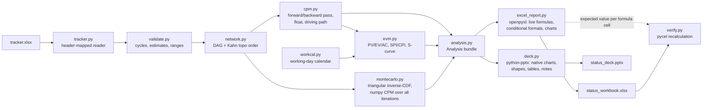

# statusdeck

statusdeck turns a project tracker kept in Microsoft Excel into two files a program manager can send out:

- **`status_workbook.xlsx`**: an Excel status workbook with live formulas. The critical-path schedule, earned value and risk scoring are all Excel formulas, not pasted numbers. If you change a duration, a % complete or the status date in Excel, the dates, float, critical flags, SPI/CPI and the Gantt bars all recalculate.
- **`status_deck.pptx`**: an 8-slide PowerPoint status deck. It has KPI tiles with red/amber/green status, a critical-path Gantt, the driving path, an earned value S-curve, a Monte Carlo finish-date histogram, schedule drivers and a risk heat map. The charts are native PowerPoint charts, so Edit Data works on them, and every slide has speaker notes saying where its numbers come from.

Behind both files is a small scheduling engine written in Python. It does a Critical Path Method (CPM) forward and backward pass with lags, total and free float, and the driving path. It computes earned value (PV, EV, AC, SV, CV, SPI, CPI, EAC, VAC, TCPI) as of the status date. It also runs a Monte Carlo schedule-risk simulation on three-point estimates, vectorised with numpy, which gives P50/P80/P90 finish dates and a per-task criticality index.

The tests and benchmark check the Excel output with **pycel**, an independent implementation of Excel's formula language. pycel recalculates the saved workbook, and every formula cell has to match the Python engine's value.

## Quick start

```bash
python -m venv .venv && . .venv/bin/activate
pip install -e ".[dev]"

statusdeck sample my_tracker.xlsx --tasks 60          # write a synthetic example tracker
statusdeck validate my_tracker.xlsx                   # cycles, bad estimates, bad % complete...
statusdeck build examples/tracker.xlsx --out out --verify
```

Output of the last command on the committed example tracker:

```
Service Campaign Rollout: 60 tasks, status 2027-04-08
  baseline finish  2027-08-27 (166 working days)
  critical path    T1 -> T2 -> T3 -> T4 -> T11 -> T14 -> T15 -> T16 -> T18 -> T20 -> T24 -> T26 -> T29 -> T30 -> T35 -> T39 -> T49 -> T53 -> T59 -> T60
  SPI 0.999 (Green)  CPI 0.961 (Green)
  Monte Carlo P50 2027-09-22  P80 2027-09-29  P(on time) 0.0%
  wrote out/status_workbook.xlsx (1127 formula cells) and out/status_deck.pptx
  pycel recalculation: 1127/1127 formula cells match
  done in 0.67s
```

The example program is synthetic: a vehicle service-campaign rollout across engineering, parts, service operations, compliance and customer communications. The generator is in `src/statusdeck/sample.py`. The Monte Carlo P50 lands nearly four weeks after the single-point plan. That gap is merge bias: right-skewed estimates on many parallel paths push the joint finish later than any one path suggests, so the chance of hitting the most-likely plan comes out close to zero.

### Tracker format

The tracker is an `.xlsx` file with these sheets. Columns are matched by header name, so you can reorder them or add extra ones.

| Sheet | Columns |
|---|---|
| `Program` | `Program`, `Start Date`, `Status Date` (label in column A, value in B) |
| `Tasks` | `ID`, `Task`, `Workstream`, `Owner`, `Predecessors` (e.g. `T3, T7+2, T9-1`: finish-to-start with lag in working days), `Optimistic (d)`, `Most Likely (d)`, `Pessimistic (d)`, `Budget`, `% Complete`, `Actual Cost` |
| `Risks` | `ID`, `Risk`, `Owner`, `Probability (1-5)`, `Impact (1-5)`, `Mitigation` |
| `Holidays` | one date per row (optional) |

`statusdeck sample` writes a tracker in exactly this format, so you can use it as a template.

## What is in the outputs

**Excel workbook**

| Sheet | Contents |
|---|---|
| Summary | Input cell for the status date, baseline finish, earned value KPIs with RAG `IF()` formulas and conditional formatting, Monte Carlo percentiles, and `COUNTIF` task/risk counts |
| Schedule | One row per task: ES/EF/LS/LF/total float/free float/critical flag as formulas (`=MAX(0,K5+2,K9)`, `=MIN(ProjFinish,L12-1,...)`), dates via `INDEX(CalDates,...)`, and a weekly Gantt drawn by formula-based conditional formatting (red = critical, blue = has float, grey = status week). Also has a data bar for MC criticality, an autofilter and frozen panes |
| EVM | Planned % per task (`=IF(E3=0,IF(Elapsed>=D3,1,0),MAX(0,MIN(1,(Elapsed-D3)/E3)))`), PV/EV/AC/SV/CV, a KPI block, a PV S-curve line chart with EV/AC markers, and data validation on % complete |
| Risks | Score `=D2*E2`, rating `IF()`, colour scale, data validation (1-5), and a 5x5 `COUNTIFS` heat map |
| MonteCarlo | Percentile table, a 20-bin histogram with a bar chart, cumulative % formulas, and the 15 most critical tasks |
| Calendar | Working day to date table (weekends and holidays removed), used through the named range `CalDates` |

The workbook uses these named ranges: `StatusDate`, `Elapsed`, `ProjFinish`, `CalDates`, `ProjStart`. It is saved with "full calculation on load", so Excel computes every value when the file is opened.

**PowerPoint deck:** title, executive summary (4 RAG KPI tiles and 5 generated bullets), schedule Gantt (up to 28 lowest-float tasks with a status-date line), driving-path table, earned value chart and table, Monte Carlo histogram and percentile table, criticality bar chart, and the risk heat map with the top-risk table.

## Architecture



Some design choices:

- **One set of conventions for Python and Excel.** The CPM, planned-% and RAG rules are written once in Python, and `excel_report.py` emits the same rules as formulas (see the docstrings in `cpm.py` and `evm.py`). For every formula cell it writes, `build_workbook` also returns the value Python computed. That is what makes the cell-by-cell pycel check possible.
- **Monte Carlo is vectorised over iterations, not tasks.** Durations are sampled as a `(tasks, iterations)` array. The forward and backward passes then loop over tasks in topological order, and each step is a numpy `maximum`/`minimum` across all iterations, so cost is O(edges x iterations) with no Python loop per iteration. A test checks that the vectorised result equals a scalar CPM run on each iteration.
- **Triangular sampling uses the inverse CDF.** `numpy.random.triangular` rejects zero-width ranges (fixed-duration tasks and milestones). The inverse CDF handles those cases, and the tests check it against the closed-form mean, variance and mode split.

## Tests

```bash
pytest -q          # 41 tests
```

What the tests check:

- **CPM** against a textbook network with hand-computed ES/LS/total/free float. Also lags (positive, negative, and clamped to the project start), cycle reporting with the actual cycle path, and invariants on 300- and 400-task random networks.
- **Earned value** against hand-computed PV/EV/AC/SPI/CPI/EAC/TCPI, plus the working-day calendar with weekends and holidays.
- **Monte Carlo**: inverse-CDF moments; zero-width estimates must reproduce CPM exactly; a serial chain must match the analytic sum; merge bias on parallel paths; seed reproducibility; and vectorised results equal to per-iteration scalar CPM.
- **Excel**: every formula cell recalculated by pycel must match the engine. Editing a duration in the saved workbook must re-plan the critical path, and editing the status date must move PV. Also checks named ranges, charts, conditional formatting and data validation.
- **PowerPoint**: slide order, every shape within the slide, speaker notes on every slide, KPI tiles and chart data equal to engine values, Gantt bars red exactly when the task is critical, and the driving-path table.
- **CLI** end to end, including the error path for a tracker with a cycle.

## Benchmark

```bash
python bench/run_bench.py          # full run, writes bench/results.md
python bench/run_bench.py --quick  # smaller run used in CI
```

These results are from the full run on an arm64 macOS machine (Python 3.12.14, numpy 2.5.4). Raw output is in [`bench/results.md`](bench/results.md). Timings will differ on other machines.

**CPM forward/backward pass**

| Tasks | Edges | CPM time (median of 5) | Tasks / s |
|---:|---:|---:|---:|
| 100 | 199 | 0.10 ms | 1,016,955 |
| 1,000 | 1,992 | 1.19 ms | 838,370 |
| 10,000 | 20,010 | 26.35 ms | 379,441 |

**Monte Carlo throughput**

| Tasks | Iterations | Time (median of 3) | Iterations / s |
|---:|---:|---:|---:|
| 60 | 10,000 | 0.009 s | 1,163,450 |
| 500 | 10,000 | 0.073 s | 136,482 |
| 2,000 | 10,000 | 0.340 s | 29,389 |

**Monte Carlo accuracy against closed-form answers** (200,000 iterations)

| Check | Expected | Simulated | Error |
|---|---:|---:|---:|
| 30-task serial chain, mean finish | 220.000 | 219.971 | 0.013% |
| 30-task serial chain, std dev | 9.309 | 9.307 | 0.032% |
| 2 parallel paths, E[max] (merge bias) | 13.444 | 13.436 | 0.065% |
| 200-task network, zero-width estimates: iterations equal to CPM | 1,000 | 1,000 | 0 |

**Excel formula fidelity** (saved workbook recalculated by pycel vs. Python engine)

| Tasks | Formula cells | Matching after pycel recalculation | Write time | Recalc time |
|---:|---:|---:|---:|---:|
| 60 | 1,127 | 1,127 (100.0%) | 0.04 s | 0.35 s |
| 300 | 5,207 | 5,207 (100.0%) | 0.11 s | 2.12 s |

**End to end, 60-task tracker to workbook and deck** (10,000 Monte Carlo iterations): 0.121 s in total, of which writing the PowerPoint deck takes 0.066 s and writing the Excel workbook 0.041 s. The workbook is 41 KiB and the deck is 75 KiB.

## Limitations

- **Finish-to-start dependencies only**, with integer working-day lags. There is no SS/FF/SF logic, no resource levelling and no task calendars or constraint dates.
- **Baseline equals current plan.** The schedule comes from the most-likely durations. Progress (% complete) feeds earned value but does not re-forecast remaining durations. In the Monte Carlo, tasks at 100% are fixed at their likely duration and every other task is sampled in full, so the simulation shows plan risk, not a progress-adjusted forecast.
- **Planned value assumes a straight-line spend** across each task's working days.
- **Some outputs are static.** The Monte Carlo results (percentiles, histogram, criticality) and the PV S-curve series are written as values, because Excel has no vectorised simulation. The Calendar sheet is also generated, so changing holidays in Excel does not move dates until you rerun `statusdeck build`.
- **pycel is not Excel.** The fidelity check uses pycel, which implements Excel semantics in Python. It is strong evidence that the formulas are right, but it is not a run inside Microsoft Excel. No licensed software is used anywhere, including CI. The Gantt conditional formatting and charts are checked structurally, not visually.
- **The example data is synthetic.** No real program data is included.
- pycel 1.0b30 reads an openpyxl attribute that was removed in openpyxl 3.1. `verify.py` adds a small compatibility shim for it.

## License

MIT
